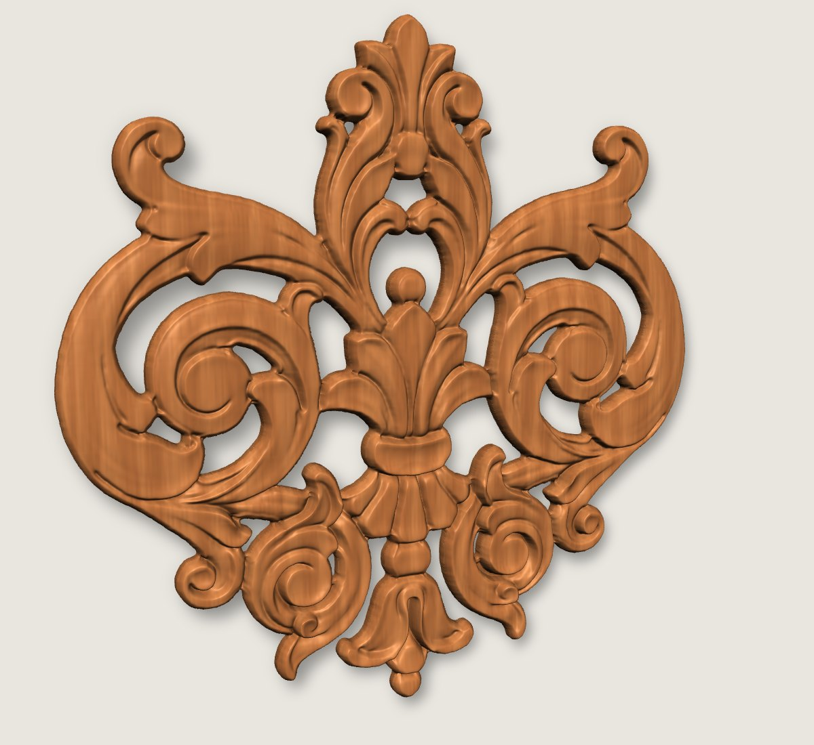

# Ornament baroc 3D

Prezentare interactivă 3D a ornamentului baroc pentru CNC: 450 × 458 mm, în grosimile de 9, 12, 20 și 30 mm (talpă de 3 mm). Interfața paginii e în rusă.



## Fișiere

- `index.html`: pagina cu vizualizatorul 3D (WebGL 2).
- `model.png`: relieful codat (înălțime, detaliu și distanța față de contur), din care pagina construiește modelul pentru fiecare grosime.
- `preview.jpg`: imaginea de mai sus.

## Pornire locală

Pagina încarcă `model.png` prin `fetch`, deci nu merge deschisă direct ca fișier. Pornește un server local în folderul repo-ului:

```
python3 -m http.server 8000
```

apoi deschide http://localhost:8000.
